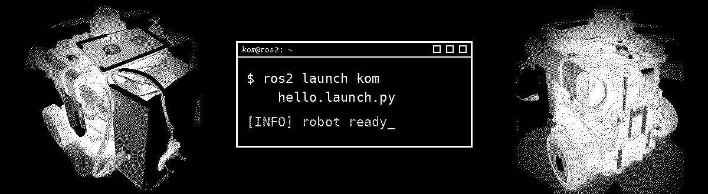
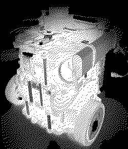

## 안녕하세요, 권오민입니다 👋

**Robot Software Developer**

`ros2 run kom hello`

ROS 2로 실물 로봇을 움직이는 코드를 짜고 있습니다.

---

### 🤖 About Me

**KOM**입니다. 로봇 SW 개발자를 목표로 교육과정에서 팀 프로젝트를 해왔습니다.

TurtleBot3로 실내 안내 로봇을 만들며 **SLAM·Nav2 자율주행**과 **ArUco 마커 도킹**을 실물에서 맞춰봤고,
LIMO PRO 순찰 로봇에서는 **YOLO 탐지 노드**를 만들어 Jetson에 올렸습니다.

Unity와 ROS 2를 연결한 **디지털 트윈**으로 로봇팔·컨베이어 공정도 만들어 봤습니다.

다음 목표는 **매니퓰레이터** 프로젝트입니다.

 

---

### 📁 Projects

| 프로젝트 | 무엇을 만들었나 | 내가 맡은 일 |
|---|---|---|
| [**TurtleBot3_com_ws**](https://github.com/KOM0123/TurtleBot3_com_ws) 2인 · 2026.08 | 실내 방문자 안내 로봇. 목적지까지 Nav2로 안내하고, 끝나면 ArUco 마커를 보고 충전 스테이션에 도킹 | SLAM 매핑, ArUco 인식·도킹 오차 계산, 사람 감지, 센서 브리지(Arduino, 후방 초음파) |
| [**LIMO_Patrol**](https://github.com/KOM0123/LIMO_Patrol) 4인 · 2026.09 | 웨이포인트를 순찰하며 바닥의 위험 물체를 찾는 LIMO PRO 순찰 로봇 | YOLO 탐지 노드. 모델 학습·비교, Jetson TensorRT 배포, 순간 오탐을 막는 3프레임 확인 필터 |
| [**DT_Index**](https://github.com/KOM0123/DT_Index) 4인 · 2026.10–11 | 로봇팔 3대·컨베이어·AGV가 있는 분류 라인의 Unity–ROS 2 디지털 트윈 | 로봇팔1 투입, 컨베이어·레인, 무게 센서·분기 게이트, 상태 패널 (Unity) |

---

### 🤝 Connect

### 💻 Tech Stack

 

ROS 2 Humble · Nav2 · SLAM · OpenCV(ArUco) · YOLOv8 / TensorRT / NCNN · Unity · Gazebo · TurtleBot3 · LIMO PRO(Jetson)

### 📊 GitHub Stats

### 📈 Activity Graph

